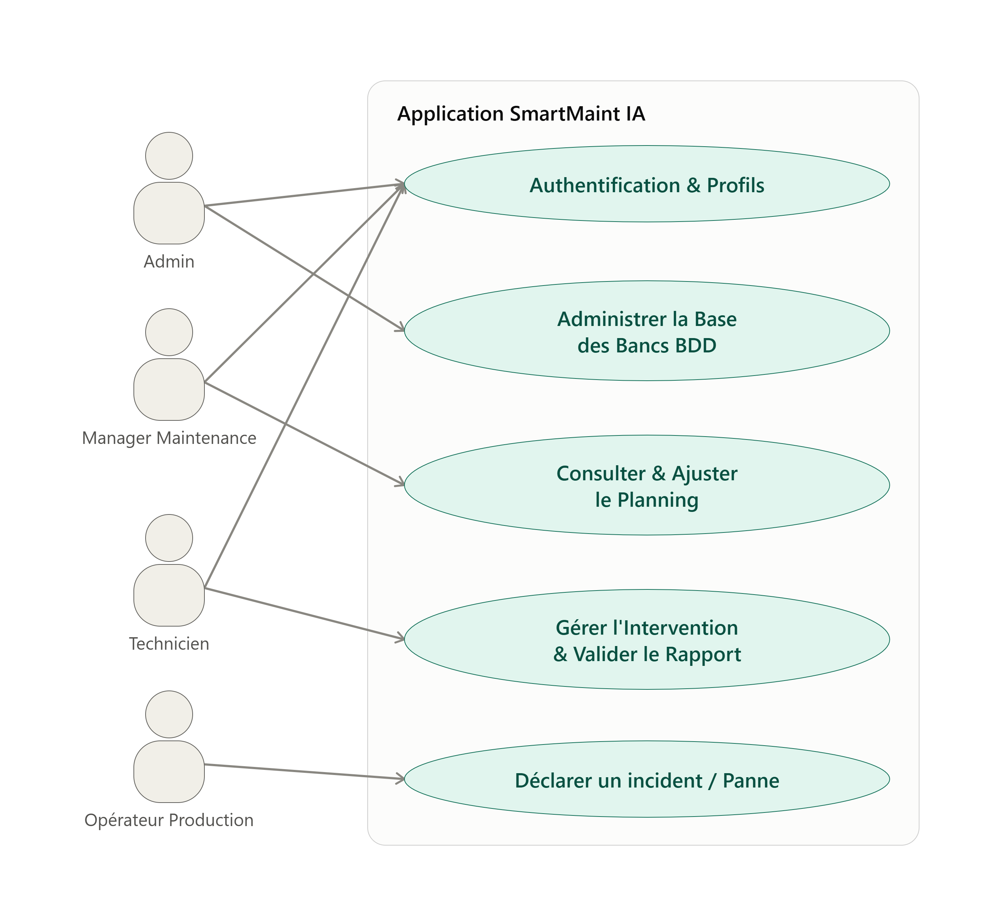
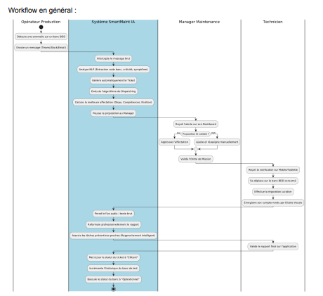
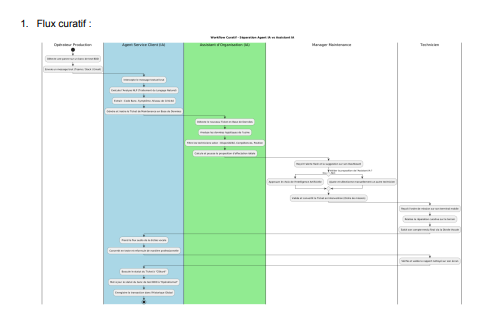
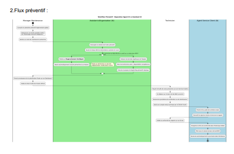
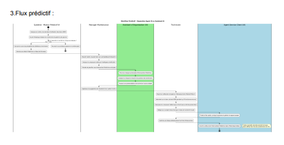
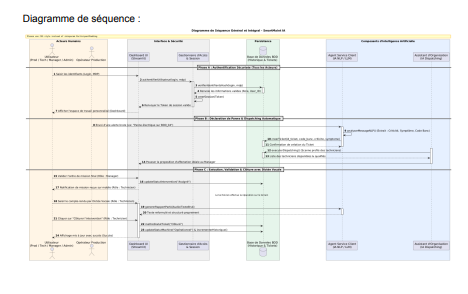
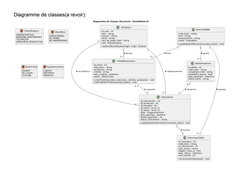
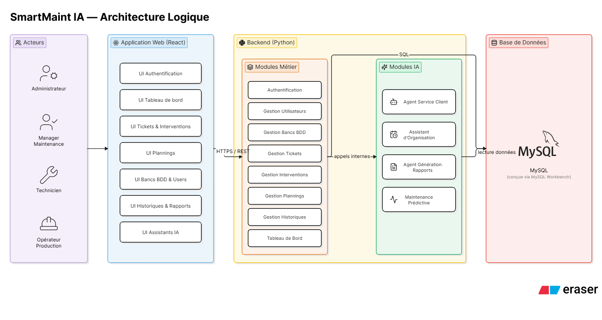
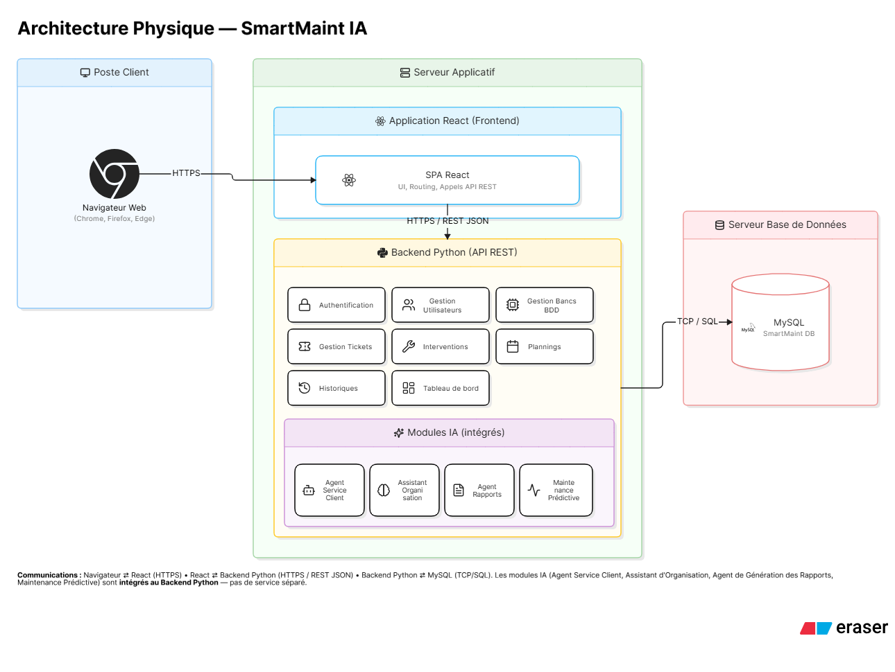

# UML.md

# Documentation UML

Projet : **SmartMaint IA**

Version : **1.0**

---

# Objectif

Ce document décrit l'ensemble des diagrammes UML utilisés dans le projet **SmartMaint IA**.

Il constitue la référence de conception permettant de comprendre le fonctionnement général de l'application, les interactions entre les acteurs, les processus métier ainsi que l'architecture du système.

Tous les développements doivent respecter les diagrammes présentés dans ce document.

---

# Diagrammes du projet

Le projet est composé des diagrammes suivants :

- Diagramme des cas d'utilisation
- Workflow général
- Flux curatif
- Flux préventif
- Flux prédictif
- Diagramme de séquence
- Diagramme de classes
- Architecture logique
- Architecture physique

Les images des diagrammes sont stockées dans le dossier :

```text
docs/
└── diagrams/
```

---

# 1. Diagramme des cas d'utilisation



## Description

Le diagramme des cas d'utilisation présente les interactions entre les acteurs et le système.

Les acteurs du projet sont :

- Administrateur
- Manager Maintenance
- Technicien
- Opérateur Production

Chaque acteur possède les droits et responsabilités définis dans le cahier des charges.

---

# 2. Workflow général



## Description

Le workflow général représente le déroulement complet du processus métier de SmartMaint IA.

Le processus comprend notamment :

1. Déclaration d'un incident.
2. Qualification automatique de l'incident.
3. Création automatique du ticket.
4. Consultation du ticket.
5. Planification de l'intervention.
6. Affectation du technicien.
7. Réalisation de l'intervention.
8. Génération automatique du rapport.
9. Clôture de l'intervention.
10. Archivage dans l'historique.

Ce workflow constitue le processus principal de l'application.

---

# 3. Flux curatif



## Description

Le flux curatif décrit le traitement complet d'un incident détecté sur un banc de test.

Les principales étapes sont :

- Déclaration d'un incident.
- Qualification de l'incident.
- Création automatique du ticket.
- Affectation d'un technicien.
- Réalisation de l'intervention.
- Génération du rapport.
- Clôture de l'intervention.

---

# 4. Flux préventif



## Description

Le flux préventif décrit les opérations de maintenance planifiées.

Les principales étapes sont :

- Création du calendrier de maintenance préventive.
- Planification des interventions.
- Affectation des techniciens.
- Réalisation des opérations.
- Validation.
- Archivage.

---

# 5. Flux prédictif



## Description

Le flux prédictif permet d'anticiper les futures opérations de maintenance.

Les principales étapes sont :

- Analyse des historiques.
- Détection des anomalies.
- Génération d'alertes.
- Proposition d'intervention.
- Validation par le Manager Maintenance.

---

# 6. Diagramme de séquence



## Description

Le diagramme de séquence représente les échanges entre les différents acteurs et le système au cours d'un scénario métier.

Il décrit notamment :

- la déclaration d'un incident ;
- la qualification automatique ;
- la création du ticket ;
- l'affectation du technicien ;
- la réalisation de l'intervention ;
- la génération automatique du rapport.

---

# 7. Diagramme de classes



## Description

Le diagramme de classes représente la structure statique du système.

Il décrit :

- les entités métier ;
- leurs attributs ;
- les relations entre les entités ;
- les cardinalités.

Toutes les évolutions de la base de données doivent respecter ce diagramme.

---

# 8. Architecture logique



## Description

L'architecture logique présente l'organisation fonctionnelle de SmartMaint IA.

Elle est composée des éléments suivants :

- Frontend React
- Backend Python (FastAPI)
- Modules d'Intelligence Artificielle
- Base de données MySQL

Elle décrit les interactions entre les différents composants logiciels.

---

# 9. Architecture physique



## Description

L'architecture physique présente la répartition des composants logiciels sur les différents nœuds du système.

Elle comprend :

- Poste Client
- Serveur Applicatif
- Serveur de Base de Données

Elle décrit les communications entre le navigateur, l'application React, le backend Python, les modules IA et la base de données MySQL.

---

# Règles

Les diagrammes UML constituent la référence de conception du projet.

Toute évolution doit être cohérente avec :

- le cahier des charges ;
- les workflows validés ;
- les règles métier ;
- l'architecture du projet.

Ne jamais modifier :

- les acteurs ;
- les relations entre les entités ;
- les cardinalités ;
- les workflows ;
- les règles métier ;
- l'architecture ;

sans validation préalable.

---

# Références

Ce document est utilisé conjointement avec :

- PROJECT.md
- CAHIER_DES_CHARGES.md
- ARCHITECTURE.md
- DATABASE.md
- API_SPECIFICATION.md
- PRODUCT_BACKLOG.md
- SPRINTS.md
- DEVELOPMENT_RULES.md
- GEMINI.md

L'ensemble de ces documents constitue la documentation officielle du projet SmartMaint IA.